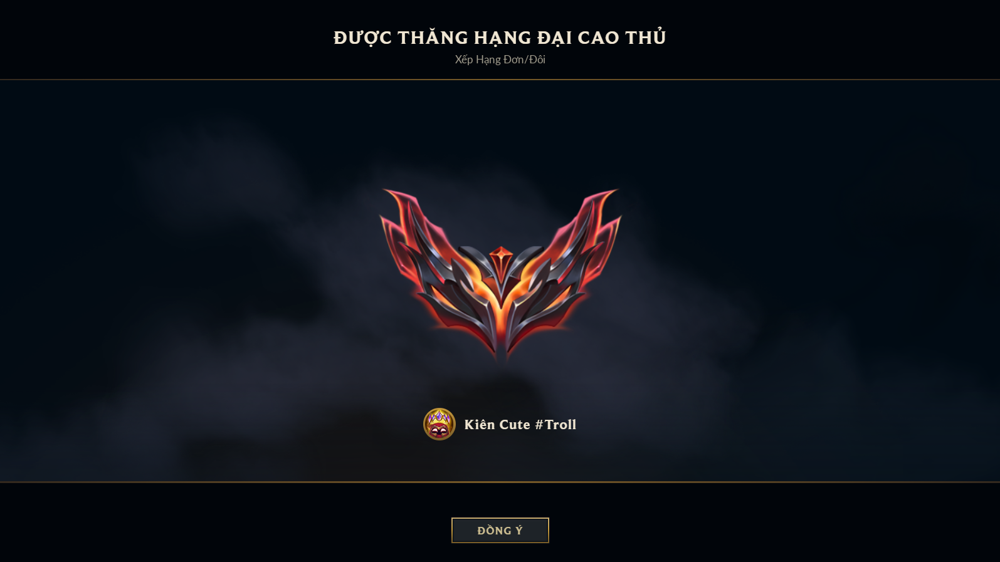

<p align="center"></p>

<p align="center"></p>

### 🌀 Gravity well

1. I've witness the born of a new age, pay Attention and you might grasp infinity itself.
2. Res assure, your Network will increase.
3. One glance is all it takes.

Tribute to the legendary <picture><source media="(prefers-color-scheme: dark)" srcset="assets/glitch-dark.svg" /></picture> for creating.. ME.

### 🕳️ What's pulling me in

| | Body | Mass |
|---|---|---|
| ⚖️ | **Team Fairness App**: AI judging, evidence logging, human review loop | Supermassive 🌍 |
| 🔥 | **Edge Detection Thesis**: fire & smoke detection on edge devices | Growing 📈 |
| 🧠 | **ML fundamentals**: attention, transformers, autobots, and decepticons | Infinite ∞ |

### 🧲 Matter on hand

<p align="center">
  
  <br /><sub>+ NumPy · Pandas</sub>
</p>

### 📐 Laws of Creation

```txt
LAW I     In all order, a secret disorder
LAW II    Open your mind, even to the Void
LAW III   Design for Mortals, not Gods
LAW IV    Vision, Might, Guile, and Sacrifice
LAW V     You cannot be a god, you must be THE GOD 
```

### 📊 Gravitational readings

<p align="center">
  
  
</p>
<p align="center">
  
</p>
<p align="center">
  
</p>

### ✨ Beyond all Realms

<p align="center">
  
  <br />
  <em>Throughout Heaven and Hell, I alone am the chosen one</em>
</p>

### 📡 Send a signal

AI/ML internships · research collaborations · feedback on the fairness app · anyone who's thought seriously about group dynamics and incentives

<p align="center">
  <a href="mailto:phongkhiem.waseco@gmail.com"></a>
  <a href="https://www.linkedin.com/in/nguyen-trung-kien-jack"></a>
</p>


